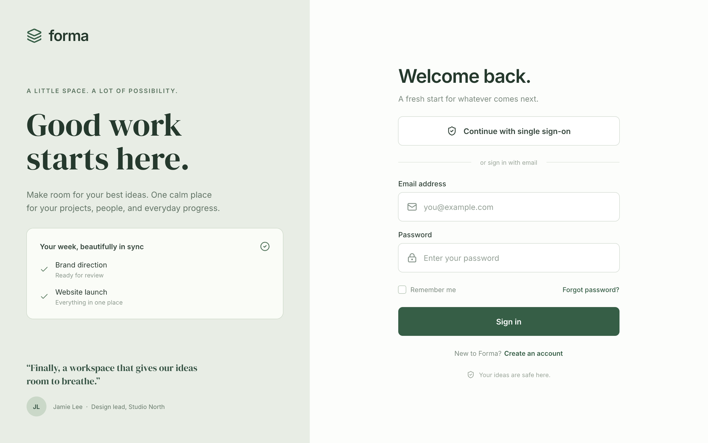
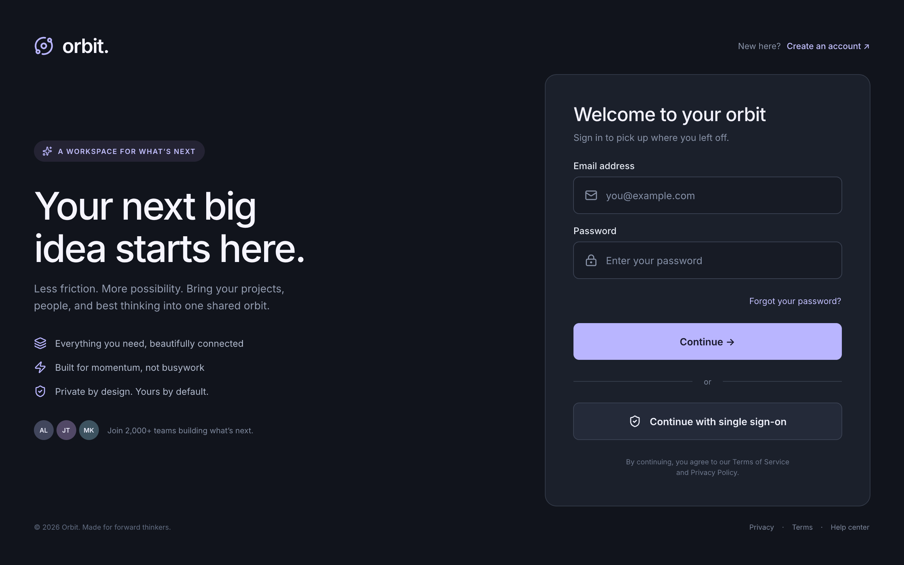

# Pencil

<p align="center">
  
  
</p>
<p align="center"><em>Two login screens designed in Pencil, saved to a .pen document, and exported with this plugin.</em></p>

Open [the editable demo](examples/login-demo.pen) to inspect both screens. These are design mockups, not an authentication implementation.

A Codex plugin that opens `.pen` design documents in an embedded Pencil editor, without adding another chat interface. A local Node.js service maintains one channel per design session. Multiple agents share a `sessionId` and can submit operations concurrently. Exclusivity applies between design sessions, not between agents within one session.

## Repository and platform

This repository, **pencil-codex**, contains one independently installable Codex plugin. Its display name is **Pencil**, and its plugin identifier is `pencil`. A future Claude-specific implementation would live in a separate `pencil-claude` repository; that implementation is not included here.

Read [the plugin manifest](plugin.json) for its identity, [the MCP configuration](mcp.json) for the stdio server, [the server](src/server.mjs) for tool-driven opening, [the session manager](src/sessions.mjs) for session ownership and agent participation, and [the editor view](web/editor.mjs) for the Pencil bridge.

## Status and requirements

**The native Codex panel is not fully working in the host tested so far.** The MCP App opens, but its WebSocket connection to the local service fails with “Canal local inaccessible dans cet hôte”. Installing the plugin and passing its protocol tests do not establish that the native panel works in your host.

The local browser preview is the real-editor validation surface. Automated HTTP/WebSocket tests require both agents' requests to reach one editor before either response is returned. Two independent agents also created distinct mockups in one real-editor session, with overlapping request intervals; both frames were captured and the shared document was saved. Opening the same document under another session scope remains rejected with `DOCUMENT_BUSY`.

Requirements:

- Codex with plugin and MCP Apps support.
- Node.js 22 or later.
- Network access to the hosted Pencil editor at `https://app.pen.dev/new?embed`.
- A host that permits the embedded pen.dev frame and connections to the loopback service.
- Bun for development and tests only.

The plugin does not redistribute the proprietary Pencil engine and does not work offline.

## Installation

```bash
codex plugin marketplace add julien-m/pencil-codex
codex plugin add pencil@pencil
```

The installable bundles are included in Git, so installation does not require a compiler or a local `node_modules` directory. Reload plugins or start a new conversation if the tools are not available in an existing conversation. Keep the native-panel limitation above in mind.

## Development and validation

```bash
git clone https://github.com/julien-m/pencil-codex.git
cd pencil-codex
bun install --frozen-lockfile
bun run build
bun run test
bun run test:protocol
```

To install from a local checkout:

```bash
codex plugin marketplace add "$PWD"
codex plugin add pencil@pencil
```

To inspect a disposable design in the standalone local browser preview:

```bash
bun run preview /absolute/path/to/example.pen
```

Open the local URL printed by that command. The preview is a development harness with its own broker; it does not automatically join the broker used by the installed MCP server. Its diagnostic output contains local connection credentials: do not publish it.

The build generates `dist/server.mjs`, `dist/daemon.mjs`, `dist/editor.html` and third-party license notices. Keep these files current when changing the source. Unit tests use Bun; the real HTTP/WebSocket transport and MCP stdio tests use Node.js, matching the installed runtime.

## Usage

1. Ask the agent to use the installed Pencil plugin. Call `pencil_open` with an absolute file path and an explicit design-session `scope`, or call `pencil_new` to create a document. The tool returns its UI resource; rendering and connecting that resource depend on the host.
2. Launch collaborating agents while the view opens. `pencil_begin` joins immediately even offline; only engine calls wait for readiness. call `pencil_tools` to discover the native schemas, then load the native instructions through `pencil_call` with `read_skill`.
3. Each agent calls `pencil_begin` to join, uses its own returned `lease` with `pencil_call`, then leaves with `pencil_end`. The legacy field name `lease` now identifies a non-exclusive participation token. Agents can join and send requests at the same time; one agent leaving does not end the others’ participation.
4. Give every agent collaborating on that document the same returned `sessionId`. Do not open the same file under another `scope` to create a second writer.

New documents start empty. Each agent creates its own frame in its first `execute`, using an orchestrator-assigned position or `FindEmptySpace`. Screen count, names, dimensions, colors and content come from the task, never a prepared scenario. Read [the plugin skill](skills/pencil/SKILL.md) before coordinating agents.

Implicit scopes use `CODEX_THREAD_ID` when available, otherwise the MCP process identity. This is not a guaranteed native conversation identifier: agents must explicitly share the returned `sessionId`. The `agent` field is an activity label, not an authenticated identity.

The plugin opens documents only through `pencil_open` or `pencil_new`. It does not register an automatic `.pen` file association.

## Startup and session metadata

`PENCIL_EDITOR_WAIT_MS` sets the maximum editor readiness wait in milliseconds (default 20000). Joining with `pencil_begin` requires no view and responds immediately. Only engine-dependent calls wait during loading. The local service advertises its effective wait and RPC deadline; MCP clients use those advertised values even when their environment differs. Expiration returns `EDITOR_OFFLINE` without sending a mutation. The readiness signal is the hosted engine bridge handshake, rather than just an open WebSocket.

Concurrent `read_skill` requests for the same path share one channel round trip, then receive independent copies of the cached response. Tool schemas use the same session cache. A reconnect creates a new engine generation and invalidates both caches. Errors are not cached. This removes repeated metadata requests; it does not shorten loading of the hosted Pencil engine or language-model preparation.

`pencil_status` exposes `openedAt`, `readyAt`, generation-local metadata counters and bounded `recentCalls` with request, dispatch and completion timestamps. Cache hits have no channel dispatch timestamp. Measure the installed `dist/` server from a clean clone without development dependencies; demonstration data belongs only in examples and test fixtures.

## Save, captures and exports

| Tool | Result |
|---|---|
| `pencil_save` | Flushes current editor changes and saves them to the opened `.pen` file, preserving a recovery copy and checking for external conflicts |
| `pencil_new` | Creates a `.pen` file at the selected absolute path and returns its editor view |
| `pencil_capture` | Captures component/screen IDs, or `["document"]` for the whole design, as PNG files in the selected directory |
| `pencil_export` | Exports PNG, JPEG, WEBP, PDF, HTML/CSS or HTML/Tailwind and returns the files actually written |
| `pencil_save_as` | Copies the last acknowledged snapshot into a new `.pen` file at the selected path |

Destination directories must already exist. `pencil_new`, `pencil_save_as`, captures and exports never overwrite an existing destination. Explicit `pencil_save` updates the currently opened file. Captures and exports require an agent participation token. Documents remain opaque to the plugin: the Pencil engine manages their contents, while the plugin transports and stores their bytes.

Native screenshots may be optimized previews; use raster export when a higher-resolution image is needed. Captures, all six export formats, document creation and Save As have been exercised on disposable test designs.

## Navigation and agent activity

The embedded view contains the real Pencil editor. Selection tools, zoom, Layers and component navigation remain available. Sign In, Goodies and settings remain as provided by Pencil; the plugin does not hide them using CSS, DOM injection or overlays.

The plugin's header lists all participating agents and marks those with requests in flight. Updates use the shared session channel. The plugin does not currently assign distinct native canvas cursors or object labels to individual agents. Its header badge is separate from any presence features provided by Pencil.

## Persistence and safeguards

Automatic editor saves keep a separate local draft. A snapshot only confirms mutations whose responses had already completed when the storage message arrived. An earlier snapshot remains `check-required`, even if its disk write finishes later; explicit Save flushes the current engine state. To update the opened `.pen` file, click **Enregistrer** in the plugin header, or have the agent call `pencil_save` with its participation token. Save asks the engine to flush its current content before publishing the draft to the source path. `pencil_status` reports `source-saved` after a successful explicit Save.

Save checks the source revision recorded when the draft was loaded. This baseline survives editor reloads and service restarts. An existing external change blocks Save; the latest draft remains available through `pencil_save_as` at a new path. Drafts from older plugin versions without a recorded baseline also require Save As.

Each source update retains the previous file in a hidden `.pencil-save-*` recovery directory beside the document. Publication preserves the displaced file and refuses to replace a competing file created at the source path. Node does not provide a portable filesystem compare-and-swap: the source path is briefly absent during publication. This is not a fully atomic transaction with independent writers or a crash-durable database. Avoid editing the same file in another application while saving; after an interrupted save, inspect `previous.pen` and `pending.pen` in the recovery directory before removing it. Open file handles held by another process can still write to the retained previous inode.

Save is available once outstanding operations have finished; calling it earlier returns `SAVE_NOT_READY`. Calls received during the flush and publication wait for Save to finish, then resume concurrently. Waiting is bounded to five seconds by default; a failed Save rejects its waiting calls with the same error, and a wait timeout returns `SAVE_WAIT_TIMEOUT` without dispatching the call. No edit queue is used outside Save. Idle agents can remain joined. The header button is disabled while requests or a Save are in progress; joining the session alone does not disable it. Save As continues to write a new destination without switching the active session to that copy.

Assets are limited to `images/` and `fonts/` beside the document. Traversal paths, symbolic links and `.pen` documents used as assets are rejected. External `.pen` libraries are not supported by this initial storage implementation. The editor's document-library/dashboard requests, including `documents-list`, are not implemented either; use the plugin tools to open or create documents.

Agents must coordinate ownership of frames or nodes; the plugin does not merge conflicting edits to the same object. Calls have distinct request IDs and are forwarded immediately without a plugin-wide queue. The hosted engine still executes synchronous JavaScript on its event loop, so concurrent requests do not imply parallel CPU execution. Avoid simultaneous edits to the same nodes, including manual edits in the editor. A timed-out operation blocks subsequent mutations; never replay an insertion with an unknown outcome. Asynchronous generation is unsupported. The syntactic rejection of `Generate(...)` is a usage guard, not a JavaScript sandbox.

## Local data and service lifecycle

When supplied by the host, `PLUGIN_DATA` stores private connection metadata and drafts. Otherwise, the plugin uses its own `.runtime/` directory. The service listens only on loopback and requires a private token. Each editor view receives a token restricted to its session.

The service survives an MCP client disconnect. To stop it explicitly, read its PID from the data directory's `connection.json` and send SIGTERM. Preserve any drafts you still need. After an interrupted startup, a stale `starting` directory may need to be removed after checking that its service is no longer running.

No API key is bundled. Session tokens are generated at runtime. Documents and drafts are stored locally, but their contents are processed by the hosted web editor. Review pen.dev's terms and network behavior before using sensitive documents.

## References and license

Read [the upstream embed proposal](https://github.com/highagency/pen-embed-demo) for the bridge and [the OpenAI plugin packaging documentation](https://developers.openai.com/plugins/build/plugins) for the package format.

This is an independent integration, not affiliated with or endorsed by Pencil or OpenAI. Read [the MIT license](LICENSE) for this integration and [the third-party notices](THIRD-PARTY-NOTICES.md) for libraries included in the bundles. The hosted Pencil engine remains subject to its publisher's terms.
